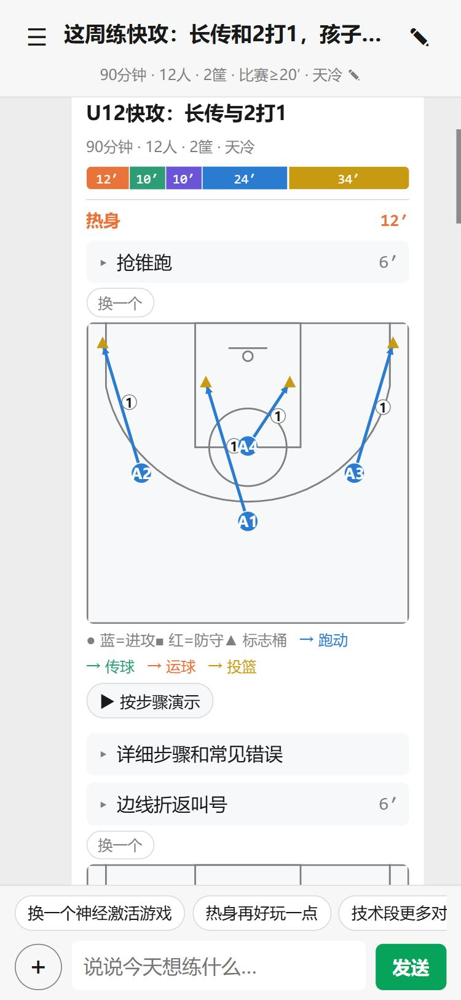

# U12 备课助手 · U12 Basketball Session Planner

**English** · [中文](README.zh-CN.md)

**Live:** https://sports-agent-seven.vercel.app (sign-in by invitation)

I coach a U12 basketball team in Germany. Planning a 90-minute session that is fun, useful and never the same as last week took me far longer than it should. So I built a planner that does it in about a minute: I say what I want to train, and it returns a full session with a court diagram for every drill.



## What it does

- **Plans a session from one sentence.** For example: "fast breaks this week: long passes and 2-on-1, the kids lose focus quickly". The plan always has five parts: warm-up, mobility, neural activation, technique, and a final game of at least 20 minutes.
- **Checks every plan with code, not trust.** A validator verifies the total time, the part order, the game length and the warm-up length in a cold hall. It also rejects an activation game used in the last four sessions. A failed plan goes back to the model once for repair.
- **Draws each drill.** The model names court spots and actions; the page computes the coordinates on a FIBA court, so players don't land in the wrong place.
- **Learns what the kids like.** After a session I rate drills 👍 or 👎. Liked drills are preferred next time, and disliked ones are blocked by the validator.
- **Runs the practice.** Practice mode shows one drill per screen with a countdown, the coaching cue and the diagram.
- **Works on phone and tablet,** and installs to the home screen.
- **Chinese and English interface.** The drills can be written in Chinese, English or German, so assistant coaches can read them.

## How I built it

I am the product owner and the domain expert. The code was written with an AI pair programmer (Claude Code). My part was the coaching model, every product decision, and testing in real use. The work went in three steps:

1. **Research.** I searched GitHub for an existing tool before building one. Nothing fit, so I took three ideas from related projects: let the model draft and let code validate; use strict JSON; repair once on failure.
2. **Prototype** (7 to 15 November 2026). It went through 21 versions. I rejected the first two designs, a form and a dark "AI" look, in favour of a plain chat that feels like WeChat.
3. **Production** (19 and 20 November 2026). The prototype moved to Vercel, Supabase and DeepSeek through small pull requests, each gated by CI.

## Engineering decisions worth a look

| Decision | Why |
|---|---|
| The model proposes, code decides | Rules such as "a game of at least 20 minutes" are checked by a deterministic validator. A wrong plan is repaired or flagged, never silently shown. |
| Named court spots instead of coordinates | Early diagrams had players in the wrong place. The model now says "top of the key" and the page does the geometry. |
| An adapter instead of a rewrite | `public/runtime.js` gives the hosted page the same interface the prototype had, so about 1,200 lines of tested page logic moved to production unchanged. |
| Tests first, including for bugs | 53 unit tests and 12 logic checks. Every bug found in review or in production got a failing test before its fix. |
| Independent code reviews | Three reviews, each by a reviewer with no prior context, found race conditions and a sign-in flaw before users did. |
| Cost and access control | Invitation-only sign-in, row-level security per coach, and a daily spending cap per person. One session costs an estimated few cents. |
| Measured, then tuned | Drawing a picture took about 25 s with the model's thinking mode and about 5 s without it, so pictures run without it. |

## Stack

Plain HTML and JavaScript with no framework and no build step · Vercel Functions (TypeScript) · Supabase (Postgres, row-level security, email-code sign-in) · DeepSeek API · GitHub Actions.

## Run it

```bash
npm install
npx vercel dev
```

Environment variables (on Vercel: Project → Settings → Environment Variables):

| Name | What |
|---|---|
| `DEEPSEEK_API_KEY` | DeepSeek API key |
| `SUPABASE_URL` | Supabase project URL |
| `SUPABASE_PUBLISHABLE_KEY` | Supabase public key (`sb_publishable_…`, or the legacy anon key as `SUPABASE_ANON_KEY`) |
| `SUPABASE_SECRET_KEY` | Supabase secret key (`sb_secret_…`, or the legacy key as `SUPABASE_SERVICE_ROLE_KEY`). Server only |
| `DEEPSEEK_MODEL`, `DEEPSEEK_REASONING_EFFORT`, `DEEPSEEK_PICTURE_EFFORT`, `DAILY_EURO_CAP` | optional; the defaults are `deepseek-flash`, `high`, `none` and `3` |

Create the tables by running `supabase/migrations/001_docs_usage.sql` once in the Supabase SQL editor.

**Add a coach:** Supabase → Authentication → Users → Add user → Create new user, with "Auto Confirm User" ticked. They sign in with the code sent to that email. "Invite user" does not work while sign-ups are off.

## Checks

```bash
npm test
npm run lint
```

For the browser test page: run `node tests/harness/build.cjs`, serve `tests/harness`, open `page.html`, then run `flow.js` and `races.js` in it. Every value they return should be `true`.

## Privacy

Plans are generated by DeepSeek, whose servers are in China. Don't type children's full names into the chat. Each coach's history is private to that coach.

## More

- [The coaching model and the product decisions](docs/specs/2026-11-07-basketball-session-agent-design.md)
- [The design of the online version](docs/specs/2026-11-19-online-deployment-design.md)
- [Current state and open items](docs/HANDOVER.md)
