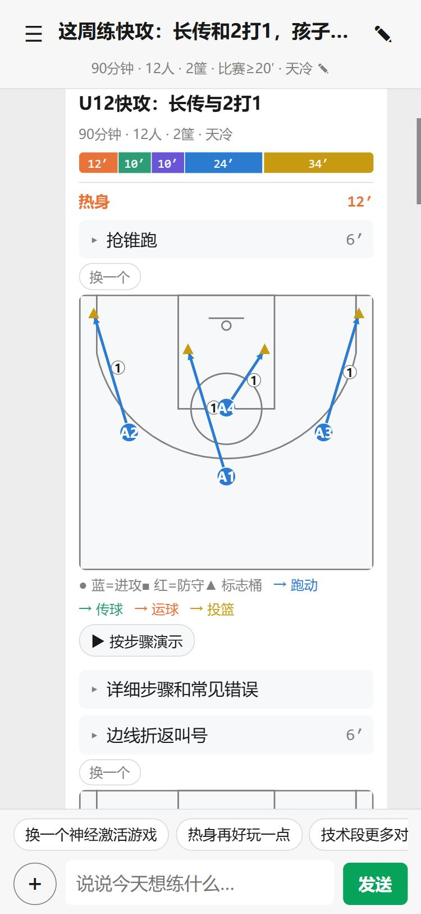

# U12 备课助手

[English](README.md) · **中文**

**线上地址：** https://sports-agent-seven.vercel.app （凭邀请登录）

我在德国带一支 U12 篮球队。一节 90 分钟的课，要有趣、要实用、还不能和上周重复，备课花的时间远比应该花的多。所以我做了这个工具，大约一分钟就能备好：我说这周想练什么，它给出一整节课，每个练习都配场地图。



## 它能做什么

- **一句话出一节课。** 比如：「这周练快攻：长传和2打1，孩子最近注意力差」。课表固定五段：热身、灵活与弹跳、神经激活、技术、至少 20 分钟的比赛。
- **每个计划都由代码检查，不靠信任。** 校验器检查总时长、五段顺序、比赛时长、天冷时的热身时长，还会拒绝最近四节课用过的神经激活游戏。没通过的计划会退回模型修一次。
- **给每个练习画图。** 模型只说位置名和动作，页面在 FIBA 标准场地上算出坐标，球员不会站错地方。
- **记住孩子喜欢什么。** 上完课给练习点 👍 或 👎。下次优先排 👍 的，👎 的由校验器直接挡掉。
- **带着上课。** 上课模式一屏一个练习，有倒计时、口令和场地图。
- **手机和平板都能用，** 可以添加到主屏幕，练习内容还能输出德语，方便给助教看。

## 我是怎么做的

我是产品负责人和领域专家，代码是和 AI 结对编程（Claude Code）写的。我负责的是训练模型、所有产品决策，以及在真实使用中测试。整个过程分三步：

1. **调研。** 动手之前，我先在 GitHub 上找有没有现成的工具。没有合适的，于是从相关项目里借了三个思路：模型起草、代码校验；严格的 JSON 输出；失败时修复一次。
2. **原型**（2026 年 11 月 7 日至 15 日）。迭代了 21 版。前两版设计被我否掉了，一版是表单，一版是深色的「AI 风」界面，最后定为像微信一样朴素的聊天界面。
3. **上线**（2026 年 11 月 19 日至 20 日）。原型通过一个个小的 PR 迁到 Vercel、Supabase 和 DeepSeek，每个 PR 都要过自动检查。

## 值得一看的工程决策

| 决策 | 原因 |
|---|---|
| 模型提方案，代码做裁决 | 「比赛至少 20 分钟」这类规则由确定性的校验器检查。不合格的计划要么被修复，要么被标出来，不会悄悄显示。 |
| 用位置名，不用坐标 | 早期的图里球员会站错位置。现在模型只说「弧顶」，几何计算交给页面。 |
| 加一层适配，不重写 | `public/runtime.js` 给线上页面提供了和原型相同的接口，约 1,200 行测试过的页面逻辑原样上线。 |
| 先写测试，修 bug 也一样 | 53 个单元测试和 12 项逻辑检查。审查或线上发现的每个 bug，都先写一个会失败的测试再修。 |
| 独立代码审查 | 三次审查，每次都由不了解背景的审查者来做，在用户遇到之前找出了竞态问题和一个登录缺陷。 |
| 成本和访问控制 | 凭邀请登录，每位教练的数据按行隔离，每人每天有费用上限。一节课的成本估计是几分钱。 |
| 先测量，再优化 | 开着模型的思考模式，画一张图约 25 秒；关掉后约 5 秒。所以画图不用思考模式。 |

## 技术栈

纯 HTML 和 JavaScript，没有框架，没有构建步骤 · Vercel Functions（TypeScript）· Supabase（Postgres、行级安全、邮箱验证码登录）· DeepSeek API · GitHub Actions。

## 运行

```bash
npm install
npx vercel dev
```

环境变量（在 Vercel：Project → Settings → Environment Variables）：

| 名称 | 说明 |
|---|---|
| `DEEPSEEK_API_KEY` | DeepSeek API 密钥 |
| `SUPABASE_URL` | Supabase 项目地址 |
| `SUPABASE_PUBLISHABLE_KEY` | Supabase 公开密钥（`sb_publishable_…`；旧版 anon key 用 `SUPABASE_ANON_KEY`） |
| `SUPABASE_SECRET_KEY` | Supabase 私密密钥（`sb_secret_…`；旧版用 `SUPABASE_SERVICE_ROLE_KEY`）。只在服务器端使用 |
| `DEEPSEEK_MODEL`、`DEEPSEEK_REASONING_EFFORT`、`DEEPSEEK_PICTURE_EFFORT`、`DAILY_EURO_CAP` | 可选；默认值是 `deepseek-flash`、`high`、`none` 和 `3` |

建表：在 Supabase 的 SQL 编辑器里运行一次 `supabase/migrations/001_docs_usage.sql`。

**添加教练：** Supabase → Authentication → Users → Add user → Create new user，勾选「Auto Confirm User」。对方用发到该邮箱的验证码登录。注册关闭时，「Invite user」不起作用。

## 检查

```bash
npm test
npm run lint
```

浏览器测试页：运行 `node tests/harness/build.cjs`，用静态服务器打开 `tests/harness` 里的 `page.html`，然后在页面里运行 `flow.js` 和 `races.js`。返回的每个值都应该是 `true`。

## 隐私

计划由 DeepSeek 生成，它的服务器在中国。请不要在聊天里输入孩子的全名。每位教练的历史记录只有自己能看到。

## 更多

- [训练模型和产品决策](docs/specs/2026-11-07-basketball-session-agent-design.md)（英文）
- [线上版本的设计](docs/specs/2026-11-19-online-deployment-design.md)（英文）
- [当前状态和待办事项](docs/HANDOVER.md)（英文）
